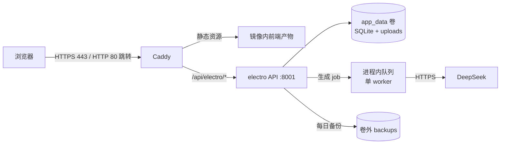
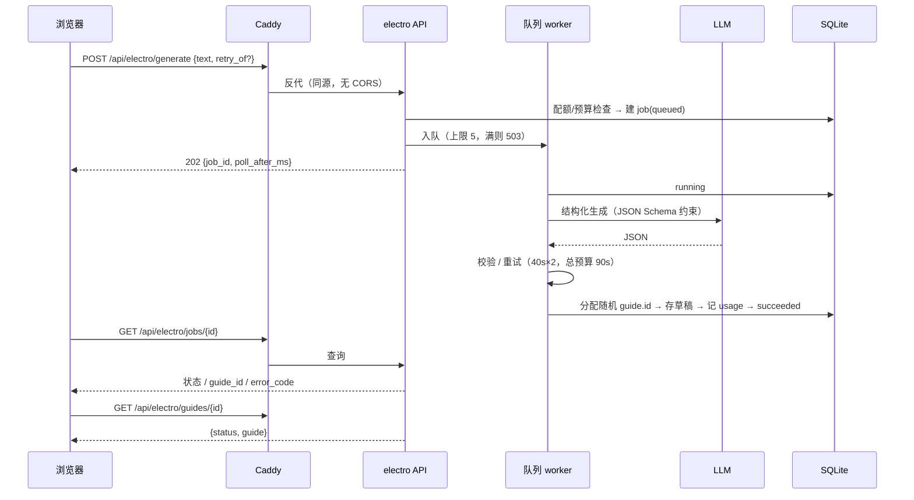
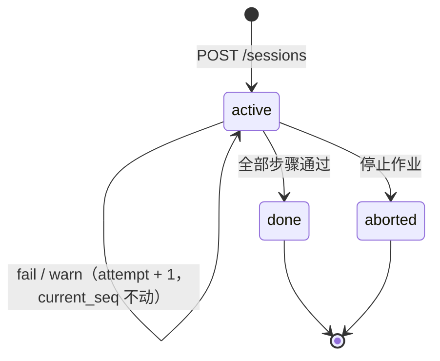
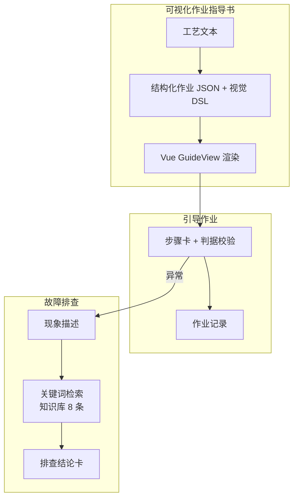

# 架构与关键取舍

> 版本 v1.2 · 状态：已确认 · 最后更新：2026-10-21
> 本文只写"为什么这样做"，操作步骤见 `OPERATIONS.md`。
> v0.2 → v1.0（2026-10-20）：修正 §3 模块图把 B 画成"向量检索"（实际是关键词检索）；删除 §4 取舍表中与 §1.2 冲突的重复行；补 A1/B 的上线状态。
> v1.0 → v1.1（2026-10-21）：补发布 CLI 已实测、真机验收通过；`apps/particle-system` 与 `apps/portal/legacy` 归档到 `archive/`（ADR-0003）。
> v1.1 → v1.2（2026-10-21）：新增 §2.2 写入治理与口令豁免；健康检查增加磁盘余量；切图独立限流与单资产上限。

## 1. 部署拓扑



单容器：`supervisord` 托管 Caddy + 一个 API。API 绑定 `127.0.0.1`，公网仅 Caddy 一个入口。
news-insight 已下架（ADR-0002），镜像内无 :8000 进程。
SQLite 自 2026-10-18 起已落地（`store/`，WAL 模式，5 张业务表 + 迁移表）；
生成链路自 2026-10-19 起线上可用（异步 job + 配额 + 草稿/发布）；
A1 引导自 2026-10-19 上线（会话状态机 + 服务端判据 + 复测留痕 + 记录打印）；
B 排查自 2026-10-20 上线（8 条知识库 + 关键词检索，不调模型）。

## 1.1 LLM 层（2026-10-18 落地，2026-10-19 补截断分类）

```
llm/
├── base.py     Provider 协议 + 九类错误（timeout/network/rate_limit/auth/server/
│               bad_request/validation/truncated/budget）
├── deepseek.py httpx 直连 OpenAI 兼容接口，JSON Output
├── runner.py   单次 40s / 最多 2 次 / 总预算 90s；校验失败回喂；截断则加倍预算并要求精简
├── prompts.py  schema 由代码生成；文档用 <document> 包裹并转义闭合标签
├── pricing.py  元/百万 token → 微元整数；高峰/空闲、缓存命中分开计价
└── factory.py  按 LLM_PROVIDER 选择实现，缺 Key 在调用点报错（不影响只读页面）
```

**错误分类先于实现**：重试与否、是否扣配额、要不要熔断，都取决于失败类型。
`auth`/`bad_request` 不重试，`validation` 重试并带上一次的错误信息，
`truncated` 单独一类——它不是"写错了"，是"写太多"，重试必须改预算与提示词，
否则同样的输入会再次撞上同一个上限。

**失败调用也计费**：`LLMError` 携带 `usage`/`cost_micros`；截断与空正文在抛错前
先把 usage 解析出来。只统计成功调用，预算熔断会在失败率最高时失灵。

**溯源字段由服务端覆盖**：`meta.model`/`source_note`/`generated_at` 不信模型——
实测它会把 `source_note` 编成"依据公开资料整理"，而它没有检索能力。

**DSL 参数放宽（决策 #15）**：`params` 允许 `string[]`（≤10 项、每项 ≤40 字、禁标记），
`schema_version` 1.1。原因见 `apps/electro-assist/api/models/visual.py` 顶部注释：
清单参数只允许标量，等于逼模型做 `a|b|c` 字符串编码，稳定性撑不住。

## 1.2 B 模块：为什么是检索，不是生成式诊断

```
knowledge/
├── door_faults.json   8 条人工整理的故障条目（现象/关键词/原因/检查顺序/升级条件）
└── eval_queries.json  11 条覆盖查询 + 2 条未覆盖查询（与知识库同仓，改库必须改题）
services/knowledge.py  KnowledgeProvider 协议 + KeywordProvider（二元组 + 同义词 + 关键词）
routers/diagnose.py    POST /diagnose（一次性 JSON）+ GET /diagnose/kb（覆盖范围）
```

**不让模型自由诊断的三个理由**：

1. 现场要的是"下一步查什么"，不是一篇分析。检索直接给出可执行顺序。
2. 生成式诊断会编出不存在的部件号、故障码和处置步骤——在作业现场这是危险品。
3. 检索是确定性的，可以量：11 条覆盖查询 Top-3 命中 **11/11**，2 条未覆盖查询全部正确回"未覆盖"，P95 **2.0ms**（`scripts/eval_diagnose.py`，451 次采样）。

**未覆盖就明说**：`uncovered_reason` 分 `system_not_covered`（问的是没收录的子系统）
与 `no_match`（有收录但现象不够接近）。阈值 `DIAGNOSE_MIN_SCORE` 默认 3.0，
宁可回"没查到"，也不给一条看起来像但其实不对的排查链。

**可替换点**：`KnowledgeProvider` 是协议，`KeywordProvider` 只是当前实现。
条目上千后可接 embedding，路由与返回结构不变——这是"embedding 可用则加、不可用不阻塞"的落法。

## 2. 请求链路（2026-10-19 已实现）



四个刻意的选择：

1. **异步 job 而非同步等待**：一次生成 5–30 秒，同步会占满连接、也扛不住刷新。
2. **单 worker 有界队列而非 BackgroundTasks**：2C2G 上并发两次生成就会互相拖慢；
   队列满时明确回 503，而不是无限堆线程。
3. **ID 由服务端分配**：模型输出的是语义化 id（`g_door_side_door_test`），两人生成
   同一工序必撞；`save_guide` 的 upsert 会把"覆盖"当成"更新"。随机 id 从根上消除这个可能。
4. **草稿不上公开列表**：`GET /guides` 只列 `published`；`GET /guides/{id}` 返回
   `{status, guide}` 信封，前端据此标"草稿"。发布走服务器 CLI
   （`python -m scripts.publish --list` / `--publish <id>`），不做后台管理。

### 2.1 A1 会话状态机（2026-10-19 落地）



三个关键取舍：

1. **判定在服务端**。客户端只提交实测值，`verdict` 由 `services/criteria.py` 算；
   请求体里塞 `verdict: "pass"` 不会生效。否则改一下请求就能把超差变合格。
2. **复测是新增尝试，不是覆盖**。`records` 每次提交 `attempt + 1`，
   旧的异常记录保留；打印页的异常链因此能回溯"第一次超差、第二次合格"。
3. **失败不推进**。`fail`/`warn` 只落记录，`current_seq` 留在原地；
   只有 `pass`/`manual` 才前进。没有"跳过"——系统不能假装某一步做过。

幂等：提交必须带 `Idempotency-Key`。同 key 重投返回原记录；
通过后换 key 重投同一步返回 `step_already_passed`；失败后换 key 才是复测。

记录：`GET /records/{session_id}` 返回整份作业（按步骤分组、含每次尝试与异常链），
打印页直接消费这个结构，不再二次拼装。

### 2.2 写入治理与口令豁免（2026-10-21）

公开站的写入面只有三类：生成、上传、切图。三者都按「每 IP 时/日 + 全站日」限流；
生成另有全站日预算 ¥3 熔断。**限流是进程内的**（单容器单 worker 前提，见 `ratelimit.py`），
重启即清零——它的作用是抬高滥用成本，不是精确计费。

口令通道只做一件事：把「每 IP 配额」换成「12 小时令牌」，用于现场连续演示/批量生成。

| 边界 | 规则 |
|---|---|
| 口令存储 | 仅服务器 `.env` 的 `ELECTRO_PASSCODE`；不配则功能整体关闭（验证接口 503） |
| 令牌 | `v1.<exp>.<HMAC-SHA256>`，有效期 12 小时；签名密钥由口令派生 |
| 豁免范围 | **只豁免每 IP 配额**；全站预算、队列上限、输入长度、结构校验一概不变 |
| 验证接口 | 每 IP 10 次/时、50 次/日；恒定时间比较；错误不区分"空/错" |
| 前端 | 令牌存 `sessionStorage`；令牌失效时清空并要求重新验证，不静默降级 |

健康检查同时看三项：进程、数据库、磁盘余量（低于 `HEALTHZ_MIN_FREE_RATIO`，默认 10% 即 degraded）。
磁盘写满时进程与 DB 都还"活着"，但上传、备份与 SQLite 写入会陆续失败；这类故障必须让部署脚本提前看见。

## 3. 模块与阶段



## 4. 关键取舍

| 决策 | 选择 | 放弃的方案 | 理由 |
|---|---|---|---|
| 仓库形态 | 单仓多模块 | 每模块一仓 | 一次构建出一个镜像，部署与回滚只有一个版本号 |
| 运行时形态 | 单容器 + supervisord | 多容器 compose | 2C2G 上 compose 的额外开销与运维复杂度不划算 |
| 入口 | Caddy | 宿主机 nginx | 自动 TLS、配置可校验、与镜像同版本发布 |
| 构建位置 | CI（海外 runner） | 服务器本地构建 | 大陆拉 Docker Hub / PyPI 不稳定，服务器应零编译 |
| 镜像来源 | 私有镜像仓 | 公共镜像仓 | 部署凭证可收敛为只读 |
| A2 生成物 | 结构化 JSON + 前端渲染 | 后端生成 HTML | 可校验、可复用、可打印；HTML 拼接是 XSS 温床 |
| B 排查 | **检索 + 人工整理的知识库** | 生成式诊断 / 向量库 | 现场要可执行顺序，不要编造；8 条用关键词足够，P95 约 2ms（§1.2） |
| 指导书 ID | **服务端随机分配** | 信任模型输出的 id | 模型 id 是语义化、可预测的，两人生成同一工序必撞；upsert 会把覆盖当更新 |
| 生成执行 | 进程内单 worker 有界队列 | BackgroundTasks / Celery | 单容器单 worker，broker 的运维成本大于收益；队列满明确 503 |
| A1 判定权 | **服务端计算** | 客户端提交 verdict | 客户端可伪造；超差必须由服务端判 fail |
| A1 复测 | **新增 attempt 记录** | 覆盖原记录 | 覆盖会丢掉异常链；"第一次超差、第二次合格"必须可回溯 |
| 视觉图示 | 构建期原语 + 声明式 DSL | 运行时生成代码 / AI 生图 | 确定性、可评审、无执行风险 |
| 模型 | 国内 API（DeepSeek 为主，通义备选） | 境外模型 | 延迟、可用性、合规 |

## 5. 相对初版的调整

| 调整 | 原因 | 记录 |
|---|---|---|
| news-insight 不进入镜像 | 实测无数据库/无进程/无数据源 Key，恢复成本高于价值 | ADR-0002 |
| 旧静态页归档不服务，门户重写 | 依赖 Tailwind CDN / Google Fonts / mediapipe，与 CSP 与"零外链"冲突 | ADR-0003 |
| A2 输入扩展为文本 + 图片 | 模型原生支持图片输入；现场文件多为截图 | `proposals/A2-IMAGE-INPUT.md`（P4 备选，未实现） |
| 图像处理引入 numpy | 像素统计用纯 Python 不可行；**仅图像模块使用**，检索层仍为纯 Python | 本文 |
| 生成链路改为「单 worker 队列 + 服务端 ID + 草稿可见性」 | 模型 id 会撞、进程重启会留死 job、未审核内容不能公开 | 本文 §2；决策 #16/#17 |
| A1 记录表重建（迁移 3） | 旧的 `UNIQUE(session_id, step_id)` 会把复测当重复丢弃 | 本文 §2.1 |

## 6. 边界与约束

- **运行时零外网依赖**（除固定几家国内 API）：字体/图标/SVG 全部打包进镜像，不引用 CDN。
- **密钥只在两处**：服务器 `.env`（600）与 CI 加密变量。文档、仓库、日志零密钥。
- **演示数据**：站点内容为公开资料虚构化改写，页面明示"非实际作业依据"。
- **单机单人**：不做多租户、不做横向扩展；容量按 2 核 2G 设计。
