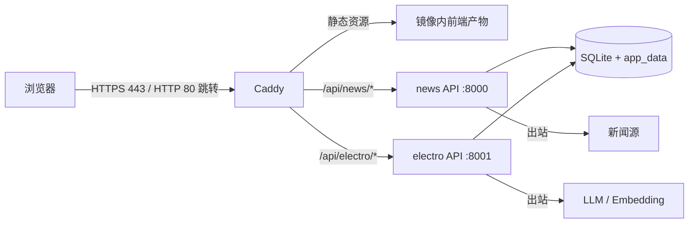
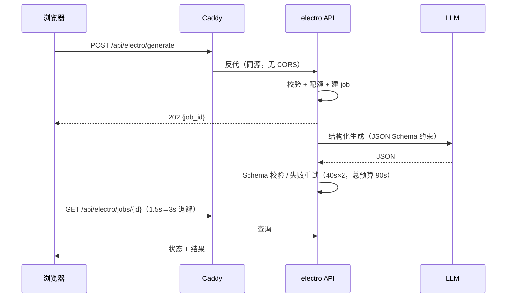
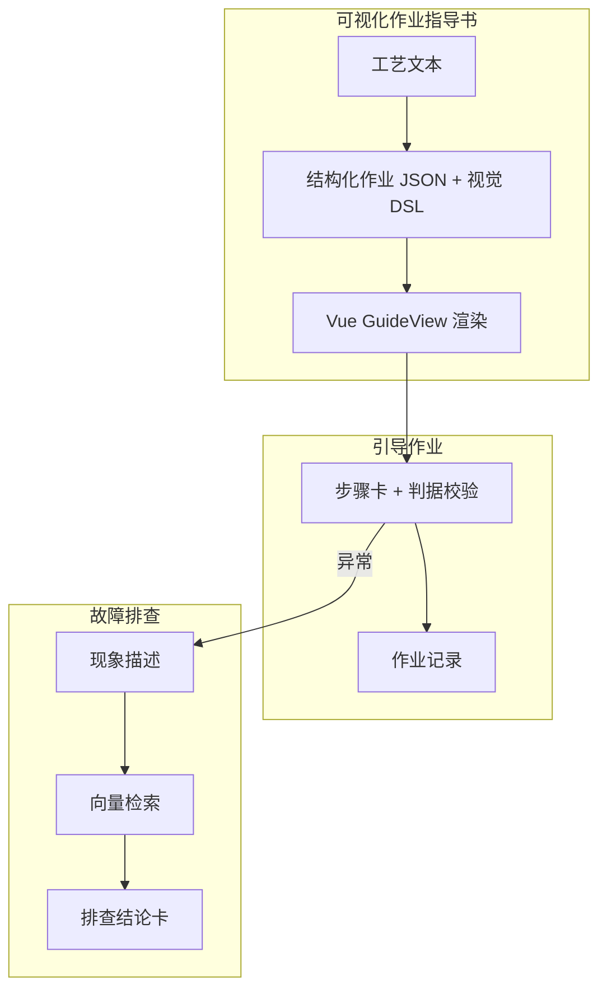

# 架构与关键取舍

> 版本 v0.1 · 状态：草案 · 最后更新：2026-10-17
> 本文只写"为什么这样做"，操作步骤见 `OPERATIONS.md`。

## 1. 部署拓扑

单容器：`supervisord` 托管 Caddy + 两个 API。API 绑定 `127.0.0.1`，公网仅 Caddy 一个入口。

## 2. 请求链路（一次指导书生成）

异步 job 而非同步等待：一次生成 5–30 秒，同步会占满连接、也扛不住刷新。

## 3. 模块与阶段

## 4. 关键取舍

| 决策 | 选择 | 放弃的方案 | 理由 |
|---|---|---|---|
| 仓库形态 | 单仓多模块 | 每模块一仓 | 一次构建出一个镜像，部署与回滚只有一个版本号 |
| 运行时形态 | 单容器 + supervisord | 多容器 compose | 2C2G 上 compose 的额外开销与运维复杂度不划算 |
| 入口 | Caddy | 宿主机 nginx | 自动 TLS、配置可校验、与镜像同版本发布 |
| 构建位置 | CI（海外 runner） | 服务器本地构建 | 大陆拉 Docker Hub / PyPI 不稳定，服务器应零编译 |
| 镜像来源 | 私有镜像仓 | 公共镜像仓 | 部署凭证可收敛为只读 |
| A2 生成物 | 结构化 JSON + 前端渲染 | 后端生成 HTML | 可校验、可复用、可打印；HTML 拼接是 XSS 温床 |
| 视觉图示 | 构建期原语 + 声明式 DSL | 运行时生成代码 / AI 生图 | 确定性、可评审、无执行风险 |
| B 模块 | 向量检索 + 生成 | 全量塞进上下文 | 知识库会随子系统膨胀，全量注入不可持续 |
| 模型 | 国内 API（DeepSeek 为主，通义备选） | 境外模型 | 延迟、可用性、合规 |

## 5. 相对初版的调整

| 调整 | 原因 | 记录 |
|---|---|---|
| news-insight 不进入镜像 | 实测无数据库/无进程/无数据源 Key，恢复成本高于价值 | ADR-0002 |
| 旧静态页归档不服务，门户重写 | 依赖 Tailwind CDN / Google Fonts / mediapipe，与 CSP 与"零外链"冲突 | ADR-0003 |
| A2 输入扩展为文本 + 图片 | 模型原生支持图片输入；现场文件多为截图 | `A2-IMAGE-INPUT.md` |
| 图像处理引入 numpy | 像素统计用纯 Python 不可行；**仅图像模块使用**，检索层仍为纯 Python | 本文 |

## 6. 边界与约束

- **运行时零外网依赖**（除固定几家国内 API）：字体/图标/SVG 全部打包进镜像，不引用 CDN。
- **密钥只在两处**：服务器 `.env`（600）与 CI 加密变量。文档、仓库、日志零密钥。
- **演示数据**：站点内容为公开资料虚构化改写，页面明示"非实际作业依据"。
- **单机单人**：不做多租户、不做横向扩展；容量按 2 核 2G 设计。
