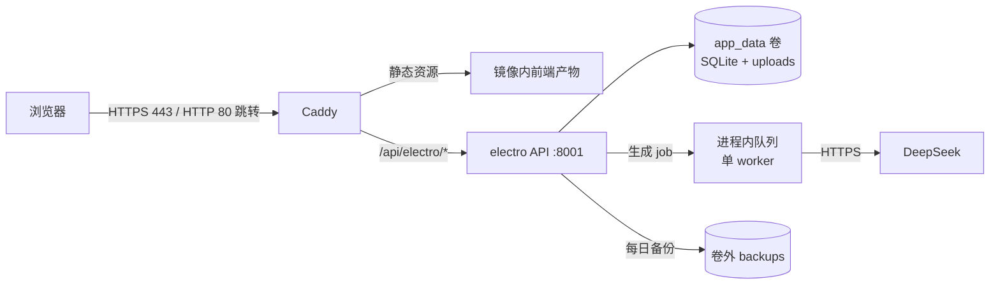
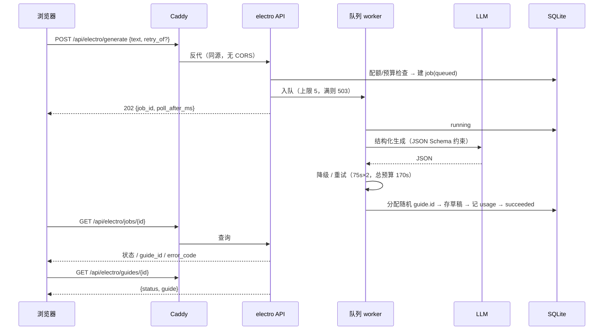
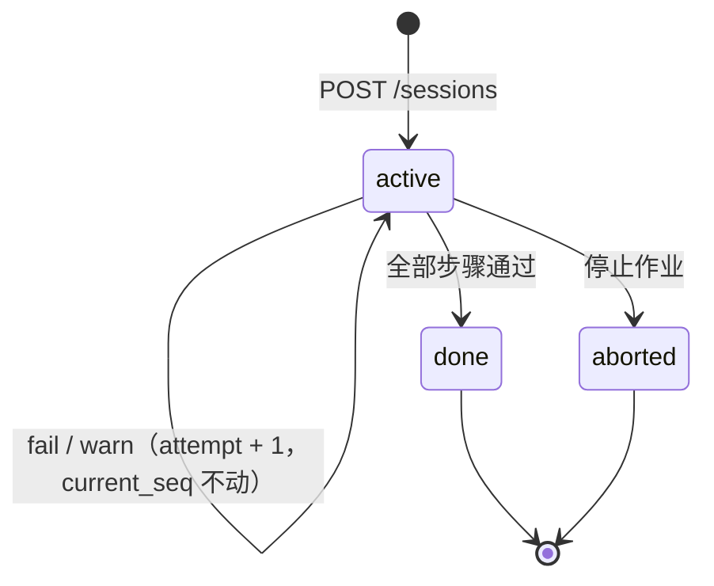
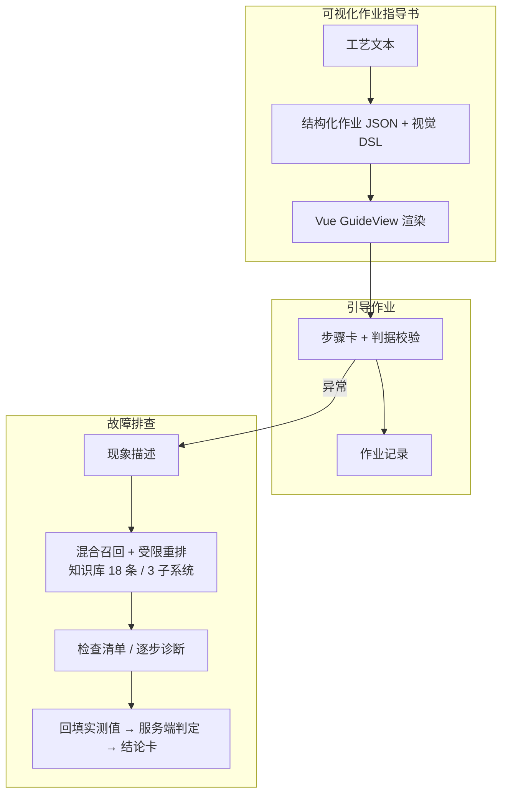

# 架构与关键取舍

> 版本 v1.5 · 状态：已确认 · 最后更新：2026-11-01
> 本文只写"为什么这样做"，操作步骤见 `OPERATIONS.md`。
> v0.2 → v1.0（2026-10-20）：修正 §3 模块图把 B 画成"向量检索"（实际是关键词检索）；删除 §4 取舍表中与 §1.2 冲突的重复行；补 A1/B 的上线状态。
> v1.0 → v1.1（2026-10-21）：补发布 CLI 已实测、真机验收通过；`apps/particle-system` 与 `apps/portal/legacy` 归档到 `archive/`（ADR-0003）。
> v1.1 → v1.2（2026-10-21）：新增 §2.2 写入治理与口令豁免；健康检查增加磁盘余量；切图独立限流与单资产上限。
> v1.2 → v1.3（2026-10-21）：B 模块升级为混合召回 + 受限重排 + 故障树回填（§1.2 重写）；知识库 18 条 / 3 子系统；迁移 v4 新增 `diagnose_runs` / `diagnose_steps`。
> v1.3 → v1.4（2026-10-30）：目录重组为「入口 + core + 领域 + data」四层；新增图片识别单通道（`POST /extract`）、工艺预检（`POST /processes`）、报告 HTML 导出与 B 结论回写；原语 7 → 13。
> v1.4 → v1.5（2026-11-01）：识别链路补上真实调用证据（§1.3）；发布闸门与列表分页落入口径（§1.1）；皮肤/分页/打印表头为何这样做（§4）。

## 1. 部署拓扑



单容器：`supervisord` 托管 Caddy + 一个 API。API 绑定 `127.0.0.1`，公网仅 Caddy 一个入口。
news-insight 已下架（ADR-0002），镜像内无 :8000 进程。
SQLite 自 2026-10-18 起已落地（`store/`，WAL 模式，8 张业务表 + 迁移表）；
生成链路自 2026-10-19 起线上可用（异步 job + 配额 + 草稿/发布）；
A1 引导自 2026-10-19 上线（会话状态机 + 服务端判据 + 复测留痕 + 记录打印）；
B 排查自 2026-10-20 上线（8 条知识库 + 关键词检索，不调模型）。
工艺原文自 2026-11-03 起落库（`processes`，保留 30 天）：详情页可凭 `process_id`
重新生成，不必回生成页重粘；`/healthz` 同时暴露 10 分钟 5xx 滚动窗口，
供部署后看门狗按「>1% 即回滚」判定（计划 §9.4 #11）。
A2 图片输入自 2026-10-29 起支持上传/切块采纳/单通道识别（识别只回填文本，人工确认后才进生成）；
**识别链路已在生产真实调用验证**（2026-10-31：1400×1050 合成工艺卡，端到端 2.26s，3/3 步 verified，
¥0.003；详见 §1.3）；作业记录可导出独立 HTML，并只读展示关联排查结论。

## 1.1 LLM 层（2026-10-18 落地，2026-10-19 补截断分类）

```
llm/
├── base.py     Provider 协议 + 九类错误（timeout/network/rate_limit/auth/server/
│               bad_request/validation/truncated/budget）
├── deepseek.py httpx 直连 OpenAI 兼容接口，JSON Output
├── runner.py   单次 75s / 最多 2 次 / 总预算 170s；校验失败先降级再生重跑；截断则加倍预算并要求精简
├── prompts.py  schema 由代码生成；文档用 <document> 包裹并转义闭合标签
├── pricing.py  元/百万 token → 微元整数；高峰/空闲、缓存命中分开计价
└── factory.py  按 LLM_PROVIDER 选择实现，缺 Key 在调用点报错（不影响只读页面）
```

**错误分类先于实现**：重试与否、是否扣配额、要不要熔断，都取决于失败类型。
`auth`/`bad_request` 不重试，`validation` 重试并带上一次的错误信息，
`truncated` 单独一类——它不是"写错了"，是"写太多"，重试必须改预算与提示词，
否则同样的输入会再次撞上同一个上限。

**失败调用也计费**：`LLMError` 携带 `usage`/`cost_micros`；截断与空正文在抛错前
先把 usage 解析出来。只统计成功调用，预算熔断会在失败率最高时失灵。

**溯源字段由服务端覆盖**：`meta.model`/`source_note`/`generated_at` 不信模型——
实测它会把 `source_note` 编成"依据公开资料整理"，而它没有检索能力。

**DSL 参数放宽（决策 #15）**：`params` 允许 `string[]`（≤10 项、每项 ≤40 字、禁标记），
`schema_version` 1.2。原因见 `apps/electro-assist/api/models/visual.py` 顶部注释：
清单参数只允许标量，等于逼模型做 `a|b|c` 字符串编码，稳定性撑不住。

**动效轨道（决策 #24）**：计划 §2.1 的 `tracks[{target, anim, duration}]` 落地为
`VisualSpec.motion`，但 `target` 收窄为**原语内部槽位**（`status_light.lamp`、
`meter.needle|readout`、`gate_state.leaf`、`flow_arrow.arrow`、`motion_timeline.segment`）。
原语是自包含组件，没有可寻址的全局图形 id；放开任意 target 等于让模型猜坐标。
三条硬约束：≤3 条轨道、同一槽位只一条、`flow`/`draw` 只能落在描边槽位
（给填充色块做描边生长会渲染成空白）。前端把轨道翻成 CSS 类而不是内联样式——
CSP `style-src 'self'` 会丢弃 `style=""`，动画写了等于没写。

**发布闸门（决策 #30）**：「草稿允许留空，发布前强制补齐」落在 `Guide.publish_blockers()`——
只查一条：每一步是否有验收判据。不放进 `model_validator`，因为那会把草稿一起判死；
不放进 HTTP 层，因为发布本来就只有 CLI 一条路。三个入口共用同一个方法：
`scripts/publish.py`（退出码 2 + 逐条列出）、`library.ensure_seeded`（缺判据的样例不上架）、
`store.refresh_sample_guide`（刷新等于重新发布，缺判据直接报错）。
理由：这是全项目唯一"结构合法但危险"的状态——一条没有判据的步骤上线后，
现场照着做却没有"做到什么程度算对"的依据。

**列表分页（决策 #30）**：`GET /guides` 收 `limit`（默认/上限 12/50）与 `offset`，
返回 `total` 与 `has_more`。排序键是 `updated_at DESC, id ASC`——只按时间排，
同秒写入的几条在翻页时会漂移，同一条重复出现或被跳过。前端按 id 去重兜底。

## 1.2 B 模块：为什么只让模型排序，不让它诊断

```
data/knowledge/
├── door_faults.json        11 条车门故障条目（现象/关键词/原因/检查顺序/升级条件）
├── hvac_faults.json        4 条空调
├── pantograph_faults.json  3 条受电弓
└── eval_queries.json       21 条覆盖查询 + 2 条未覆盖查询（与知识库同仓，改库必须改题）
services/knowledge.py   KnowledgeProvider 协议 + HybridProvider（现行）+ KeywordProvider / FullInjectionProvider（对照）
services/rerank.py      受限 LLM 重排：模型只对候选 id 排序，不能新增事实
services/diagnosis.py   故障树推进：回填实测值 → 服务端判超差 → 异常即收敛到结论
routers/diagnose.py     POST /diagnose + GET /diagnose/kb + /diagnose/runs 四端点
```

**不让模型自由诊断的三个理由**：

1. 现场要的是"下一步查什么"，不是一篇分析。检索直接给出可执行顺序。
2. 生成式诊断会编出不存在的部件号、故障码和处置步骤——在作业现场这是危险品。
3. 检索是确定性的，可以量：21 条覆盖查询 Top-3 命中 **21/21**，2 条未覆盖查询全部正确回"未覆盖"，P50 **2.8ms** / P95 **5.3ms**（`scripts/eval_diagnose.py`，2026-11-01，441 采样；两次复跑 P95 在 4.4–5.3ms 之间波动，属机器负载差异）。

**模型参与的唯一位置是重排**：输入只有候选 `id + 标题 + 已有人工原因`，输出只允许
`{"order": [...], "reason": "..."}`；不在候选集合里的 id 一律丢弃，漏掉的候选按原序补回。
调用失败、超时、JSON 不合法都回退检索顺序——重排是加分项，不能成为单点。

**混合召回**：人工关键词分（现场原话必中）+ 进程内 n-gram/IDF 稀疏向量分（换个说法也能找到），
加权 0.65/0.35；两者都低于阈值才判"不够接近"。向量入口取 **0.10**：再高只剩单候选（重排无从发挥），
再低会把"面板温度显示不对"拉到车门条目上。不引入 embedding 服务与向量库：
18 条规模下，进程内计算 P95 5.3ms，而外部依赖会多一个故障域。

**重排的两个护栏**：①**独立日预算**（`RERANK_DAY_MICROS`，默认 ¥0.3）——检索是免费功能，
不该把生成的 ¥3 花掉；预算耗尽只是跳过重排，检索照常返回。②**10 分钟缓存**（按 query + 候选集），
演示里同一句话反复问不重复付费、不重复等待（实测 1.2s → 命中后 <10ms）。

**故障树与回填**：检查项分 `confirm`（现场判正常/异常）与 `measure`（回填实测值 + 单位 + 范围）。
实测值先过 `math.isfinite`：`NaN` 与任何数比较都是 False，不挡就会直接落进"通过"分支——等于绕过判定。
顺序由服务端持有，客户端只能提交"当前这一项"；超差判定、下一项跳转、结论生成都在服务端。
一项异常即收敛到结论（原因 / 处置 / 升级 / 安全提示），不必走完整张清单。

**未覆盖就明说**：`uncovered_reason` 分 `system_not_covered`（问的是没收录的子系统）
与 `no_match`（有收录但现象不够接近）。阈值 `DIAGNOSE_MIN_SCORE` 默认 3.0，
宁可回"没查到"，也不给一条看起来像但其实不对的排查链。

**可替换点**：`KnowledgeProvider` 是协议，当前实现是 `HybridProvider`；`KeywordProvider`
保留用于降级与对照，`FullInjectionProvider` 把小知识库的全部条目交给重排模型
（`KNOWLEDGE_PROVIDER=full`，≤20 条，超过自动回退 hybrid）。三者在同一评测集上可对比：
`scripts/eval_diagnose.py --quick --json --provider full`。条目上万后可换成 embedding + 向量库，
路由与返回结构不变。

**权重、匹配度与置信度**：条目的 `likely_causes` 是 `{text, weight}`（旧字符串按序列补默认权重）；
快速检索回 `confidence`，但**对外只叫「匹配度」**——它是 `score/10` 的相似度，combined 分数天然
落在 4–6，说成"置信度"会让一条完全正确的 Top-1 命中显示为 47%，现场会误判为不可靠。
真正的「置信度」只留给逐步诊断的结论：`confidence + basis`（实测超差 > 人工确认 > 未定位 > 中止）。
两者都是工程口径，不是概率承诺。

## 1.3 识别链路：为什么"能跑"要单独取证

`POST /extract` 在 2026-10-29 上线时只有 8 条 stub 契约测试——stub 证明的是**契约**，
不是**模型**。10-31 在容器内做了一次真实调用（不把图传到外部站点）：

| 观测 | 值 | 说明 |
|---|---|---|
| 尺寸守门 | 900×640 被拒 `too_small` | 长边门槛 1000px 生效，不是只写在文档里 |
| 端到端 | **2.26s**（`latency_ms=2203`） | 与生成 8–15s 相比，识别是"点一下等两秒" |
| 结构 | `lines=9 / steps=3 / verified_steps=3` | 三层校验逐项通过 |
| 数值 | `0 V`、`2.0-3.5 s` 原样保留 | 没有把 `2.0` "顺手"改成 `2` |
| 成本 | `cost_micros=2934`（≈¥0.003） | 与 `/healthz` 的 budget 同步 |
| 诚实提示 | 主动指出"步骤与判据排成两行" | 模型自己报不确定性，比装作没看见有用 |

结论：这条链路**不是只活在测试里**。仍未验证的只有"中文实拍截图"——容器无 CJK 字体，
需要人在页面上点一次；识别质量取决于模型，不取决于字体。

## 2. 请求链路（2026-10-19 已实现）



四个刻意的选择：

1. **异步 job 而非同步等待**：一次生成 5–30 秒，同步会占满连接、也扛不住刷新。
2. **单 worker 有界队列而非 BackgroundTasks**：2C2G 上并发两次生成就会互相拖慢；
   队列满时明确回 503，而不是无限堆线程。
3. **ID 由服务端分配**：模型输出的是语义化 id（`g_door_side_door_test`），两人生成
   同一工序必撞；`save_guide` 的 upsert 会把"覆盖"当成"更新"。随机 id 从根上消除这个可能。
4. **草稿不上公开列表**：`GET /guides` 只列 `published`；`GET /guides/{id}` 返回
   `{status, guide}` 信封，前端据此标"草稿"。发布走服务器 CLI
   （`python -m scripts.publish --list` / `--publish <id>`），不做后台管理。

### 2.1 A1 会话状态机（2026-10-19 落地）



三个关键取舍：

1. **判定在服务端**。客户端只提交实测值，`verdict` 由 `services/criteria.py` 算；
   请求体里塞 `verdict: "pass"` 不会生效。否则改一下请求就能把超差变合格。
2. **复测是新增尝试，不是覆盖**。`records` 每次提交 `attempt + 1`，
   旧的异常记录保留；打印页的异常链因此能回溯"第一次超差、第二次合格"。
3. **失败不推进**。`fail`/`warn` 只落记录，`current_seq` 留在原地；
   只有 `pass`/`manual` 才前进。没有"跳过"——系统不能假装某一步做过。

幂等：提交必须带 `Idempotency-Key`。同 key 重投返回原记录；
通过后换 key 重投同一步返回 `step_already_passed`；失败后换 key 才是复测。

记录：`GET /records/{session_id}` 返回整份作业（按步骤分组、含每次尝试与异常链），
打印页直接消费这个结构，不再二次拼装。

### 2.2 写入治理与口令豁免（2026-10-21）

公开站的写入面只有三类：生成、上传、切图。三者都按「每 IP 时/日 + 全站日」限流；
生成另有全站日预算 ¥3 熔断。**限流是进程内的**（单容器单 worker 前提，见 `core/ratelimit.py`），
重启即清零——它的作用是抬高滥用成本，不是精确计费。

口令通道只做一件事：把「每 IP 配额」换成「12 小时令牌」，用于现场连续演示/批量生成。

| 边界 | 规则 |
|---|---|
| 口令存储 | 仅服务器 `.env` 的 `ELECTRO_PASSCODE`；不配则功能整体关闭（验证接口 503） |
| 令牌 | `v1.<exp>.<HMAC-SHA256>`，有效期 12 小时；签名密钥由口令派生 |
| 豁免范围 | **只豁免每 IP 配额**；全站预算、队列上限、输入长度、结构校验一概不变 |
| 验证接口 | 每 IP 10 次/时、50 次/日；恒定时间比较；错误不区分"空/错" |
| 前端 | 令牌存 `sessionStorage`；令牌失效时清空并要求重新验证，不静默降级 |

健康检查同时看三项：进程、数据库、磁盘余量（低于 `HEALTHZ_MIN_FREE_RATIO`，默认 10% 即 degraded）。
磁盘写满时进程与 DB 都还"活着"，但上传、备份与 SQLite 写入会陆续失败；这类故障必须让部署脚本提前看见。

## 3. 模块与阶段



## 4. 关键取舍

| 决策 | 选择 | 放弃的方案 | 理由 |
|---|---|---|---|
| 仓库形态 | 单仓多模块 | 每模块一仓 | 一次构建出一个镜像，部署与回滚只有一个版本号 |
| 运行时形态 | 单容器 + supervisord | 多容器 compose | 2C2G 上 compose 的额外开销与运维复杂度不划算 |
| 入口 | Caddy | 宿主机 nginx | 自动 TLS、配置可校验、与镜像同版本发布 |
| 构建位置 | CI（海外 runner） | 服务器本地构建 | 大陆拉 Docker Hub / PyPI 不稳定，服务器应零编译 |
| 镜像来源 | 私有镜像仓 | 公共镜像仓 | 部署凭证可收敛为只读 |
| A2 生成物 | 结构化 JSON + 前端渲染 | 后端生成 HTML | 可校验、可复用、可打印；HTML 拼接是 XSS 温床 |
| B 排查 | **人工知识库 + 混合召回 + 只许排序的模型** | 生成式诊断 / 外部 embedding | 现场要可执行顺序，不要编造；18 条用进程内稀疏向量足够，P95 约 5ms（§1.2） |
| 指导书 ID | **服务端随机分配** | 信任模型输出的 id | 模型 id 是语义化、可预测的，两人生成同一工序必撞；upsert 会把覆盖当更新 |
| 生成执行 | 进程内单 worker 有界队列 | BackgroundTasks / Celery | 单容器单 worker，broker 的运维成本大于收益；队列满明确 503 |
| A1 判定权 | **服务端计算** | 客户端提交 verdict | 客户端可伪造；超差必须由服务端判 fail |
| A1 复测 | **新增 attempt 记录** | 覆盖原记录 | 覆盖会丢掉异常链；"第一次超差、第二次合格"必须可回溯 |
| 视觉图示 | 构建期原语 + 声明式 DSL | 运行时生成代码 / AI 生图 | 确定性、可评审、无执行风险 |
| 模型 | 国内 API（DeepSeek 为主，通义备选） | 境外模型 | 延迟、可用性、合规 |
| 现场素材归属 | **人挂位置**（草稿页归位） | 模型按说明自动分配 | 模型没看过图，分配就是编；错位在现场不会被发现，只会被照着做 |
| 图片处理边界 | **识别是独立入口**：`POST /extract` 只回填文本、必须人工核对；生成链路仍看不到图 | 把识别塞进生成链路 / 双通道 OCR | 读图会漏行会补数；把它做成"另一个入口 + 强制确认"，错了也不会直接变成作业依据 |
| 识别通道 | **同模型两段式**：A 只转录、B 只吃 A 的文本出字段 | OCR 引擎 + 多模态异源双通道 | 模型不返回 bbox，异源"交叉验证"无法验证；两段式让字段回溯变成确定性判断，代价是延迟与成本翻倍（决策 #37） |
| 工艺实体 | **最小落库**：只存原文 + 派生标题，不存预检结果 | 建完整工艺模型（工位/工具/版本链）/ 完全不落库 | 消费者只有一个——详情页的「重新生成」；预检是规则的确定性输出，存下来只会与规则漂移。`save=false` 仍是纯预检，老调用方行为不变 |
| 报告导出 | **服务端渲自包含 HTML** | 前端拼字符串 / 只留打印 | 报告要能离线双击打开；转义必须在服务端做，下载后打开同样会执行脚本 |
| 皮肤 | **手动开关、不跟随系统** | `prefers-color-scheme` 自动切换 | 现场强光与夜间巡检都要"由人决定"；自动切换会在打印与交接班时给出不一致的界面 |
| 列表分页 | **`limit/offset` + 12/页** | 一次拉全量 / 无限滚动 | 打印需要确定的上界，无限滚动破坏 Ctrl+F 与页脚可达性 |

## 5. 相对初版的调整

| 调整 | 原因 | 记录 |
|---|---|---|
| news-insight 不进入镜像 | 实测无数据库/无进程/无数据源 Key，恢复成本高于价值 | ADR-0002 |
| 旧静态页归档不服务，门户重写 | 依赖 Tailwind CDN / Google Fonts / mediapipe，与 CSP 与"零外链"冲突 | ADR-0003 |
| A2 输入扩展为文本 + 图片 | 模型原生支持图片输入；现场文件多为截图 | 上传/切图/切块采纳/素材排版（schema 1.2）已上线；`POST /extract` 单通道识别已落地，见 `DEVELOPMENT.md §5.3` |
| 图像处理引入 numpy | 像素统计用纯 Python 不可行；**仅图像模块使用**，检索层仍为纯 Python | 本文 |
| 生成链路改为「单 worker 队列 + 服务端 ID + 草稿可见性」 | 模型 id 会撞、进程重启会留死 job、未审核内容不能公开 | 本文 §2；决策 #16/#17 |
| A1 记录表重建（迁移 3） | 旧的 `UNIQUE(session_id, step_id)` 会把复测当重复丢弃 | 本文 §2.1 |

## 6. 边界与约束

- **运行时零外网依赖**（除固定几家国内 API）：字体/图标/SVG 全部打包进镜像，不引用 CDN。
- **密钥只在两处**：服务器 `.env`（600）与 CI 加密变量。文档、仓库、日志零密钥。
- **演示数据**：站点内容为公开资料虚构化改写，页面明示"非实际作业依据"。
- **单机单人**：不做多租户、不做横向扩展；容量按 2 核 2G 设计。
