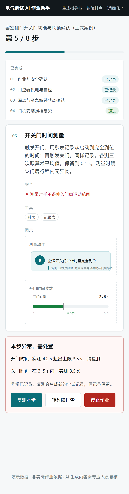
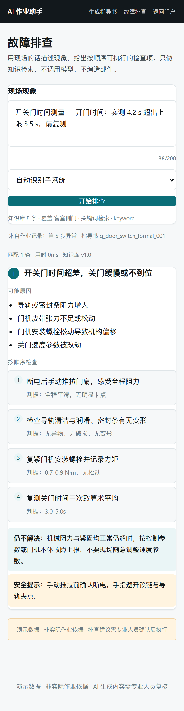
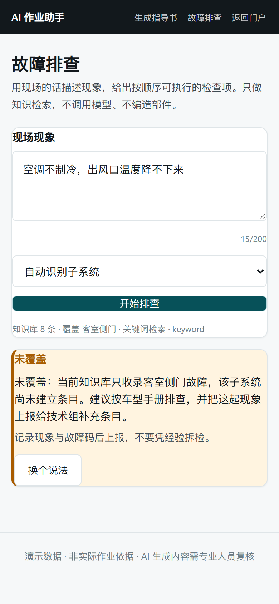

# 演示脚本（5 分钟）

> 版本 v1.1 · 2026-10-21
> 目标：让一个没做过调试的人，在 5 分钟内看懂「工艺文本 → 指导书 → 引导作业 → 异常 → 排查 → 记录」是一条闭环。
> 录屏：`docs/assets/demo.webm`（85 秒，无旁白，按下文旁白讲）。
> 真机验收已通过（Honor/5G）：8 步 + 超差复测 + 3 页打印；演示时可主动说明"这是手机上实际跑过的"。

| 作业异常 | 一键转排查（带上下文） | 未覆盖 |
|---|---|---|
|  |  |  |

## 0. 演示前 30 秒检查

```bash
curl -s <演示站>/healthz                 # {"status":"ok","checks":{"electro":"ok","db":"ok"}}
curl -s <演示站>/api/electro/guides      # count >= 5（车门 3 + 空调 1 + 受电弓 1）
curl -s <演示站>/api/electro/quota       # 至少留 1 次生成额度
```

| 兜底项 | 值 | 用途 |
|---|---|---|
| 预生成指导书 | `g_door_switch_formal_001`（正式案例，8 步） | 生成失败或额度用尽时直接打开 |
| 迁移案例 | `g_hvac_cooling_check`（空调制冷，5 步） | 被问"换个系统还能不能用"时直接打开 |
| 预跑作业记录 | 演示当天用 `scripts/demo_flow.py` 生成并记下链接 | 引导环节卡住时直接展示记录页 |
| 知识库 | 18 条 / 3 子系统（车门 11、空调 4、受电弓 3），`GET /api/electro/diagnose/kb` | 排查环节的覆盖范围 |

> 现场网络不可靠时，先打开三个标签页：列表、正式案例、预跑记录。演示不依赖实时生成。

## 1. 开场（0:00–0:20）

**做**：打开演示站首页 → 电气调试助手列表。

**说**：
- 这是一个「工艺文本 → 可视化指导书 → 现场引导 → 故障排查」的闭环 Demo；
- 全部内容是公开资料改写 + 虚构参数，页脚有「演示数据 · 非实际作业依据」；
- 关键点不是"AI 写得像"，而是**每一步都有判据、有记录、有兜底**。

## 2. 生成一份指导书（0:20–1:40）

**做**：点「生成指导书」→ 粘贴下面这段 → 提交 → 等 15 秒左右 → 自动跳到详情页。

```text
工序：客室侧门开关门功能与联锁确认
1. 确认车辆断电挂牌、防溜车到位、门扇运动范围内无人员与障碍物。
2. 测量门控器 X1-1 与 X1-2 之间供电，额定 DC110V，允许 99-121V。
3. 确认隔离锁在正常位、紧急解锁手柄已复位。
4. 门机安装螺栓力矩 0.7-0.9 N·m。
5. 开关门时间：开门 2.0-3.5s，关门 3.0-5.0s，各测三次取平均。
6. 防夹：软质障碍块触发后门自动重开，6-12s 后重试。
7. 锁闭信号 100% 关闭，门扇间隙 2.0-5.0mm。
```

**可选加演·现场素材**（30 秒，被问"能不能带现场照片"时用）：

1. 生成前在「现场素材」里传一张手机截图，说明写「门机力矩测量位置」；
2. 生成完成后，页面顶部「素材归位」把这张图选到对应步骤，保存；
3. 滚到那一步，指着图说：**系统不识别图片内容**——模型没看过它，位置是人挂的。
   这样错位能改、也不会出现"AI 猜错了图"这种无法追溯的事。

**说**（页面往下滚，停在接线图上）：
- 模型输出的不是一段文字，是**受 schema 约束的结构化数据**：步骤、判据、图元、安全提示分开存；
- 图不是模型画的，是从 7 个固定原语里选参数（接插件针脚、端子线色、仪表量程），渲染失败会降级成文字；
- 这一步的验收标准是"陌生人 60 秒内能说出：这是检查车门、共几步、判据是多少"。

## 3. 按指导书作业（1:40–3:10）

**做**：点「开始引导作业」→ 前 4 步按提示填（第 2 步供电填 110、自检选"通过"）→ 第 5 步**故意填 4.2**（超上限 3.5）→ 提交。

**说**：
- 每一步的判定在**服务端**算，客户端改请求体改不了结论；
- 超差不会"下一步"，也不会假装通过——它停在原地，要求复测或中止；
- 现场网络不稳，重复提交由 `Idempotency-Key` + 唯一约束兜住，不会产生第二条记录。

**做**：点「转故障排查」→ 自动带症状跳转 → 展示 Top-3 检查 → 点第一条的「按这条逐步诊断」。

**说**：
- 异常不是丢给用户一句"请检查"，而是带着"哪一步、哪条判据、实测多少"进入排查；
- 检索是**混合召回**：人工关键词（现场原话必中）+ 进程内稀疏向量（换个说法也能找到），条目上的 `关键词 / 向量 / 综合` 三个分直接显示；
- 模型只在**重排**时参与：它拿到的只有候选 id 和已有人工原因，只能排序；不在候选里的 id 一律丢弃，调用失败就回退检索顺序；
- 每条建议都来自公开资料改写的人工知识库，查不到会明确说"未覆盖"。

**做（逐步诊断，30 秒）**：在「门到关闭位不锁闭」这类现象下起步 → 首项是**实测值**（气压 MPa）→ 故意填 `0.2`（低于 0.45）→ 提交。

**说**：
- 超差不是前端算的：前端只提交实测值，**是否超差、下一项是谁、结论是什么都在服务端**；
- 一项异常就直接收敛到结论：原因 + 处置 + 升级条件 + 安全提示，不用把整张清单走完；
- 顺序由服务端持有，跳步提交会被 409 拒绝；结束后不能再改，保证结论与已填记录一致；
- 知识库换子系统也能走：空调、受电弓各有条目，问制动/雨刷会明确回"未覆盖"。

## 4. 复测与记录（3:10–4:20）

**做**：返回作业页 →「复测本步」→ 填 3.1 → 通过 → 完成剩余 3 步 → 完成 → 记录页 → 点「打印 / 导出 PDF」。

**说**：
- 复测保留上一次填写值，只改超差项；
- 记录页保留**每一次尝试**：4.2 和 3.1 都在，异常链单独成节，可直接打印归档；8 步案例实测 **3 页**（步骤 1–3 / 4–8 / 异常链），无截断。
- 这就是"可追溯"：不是记录一个结论，而是记录结论怎么来的。

## 5. 收尾：边界与取舍（4:20–5:00）

**说**（三点，每点一句）：
1. **不做运行时 Agent 代码生成**：图元是构建期固定的枚举，模型只输出规格，渲染在前端；这是为了现场可预期。
2. **不引入向量库**：8 条知识库用关键词 + 二元组就够，P95 是毫秒级；等条目上千再换 embedding，接口已经抽象成 `KnowledgeProvider`。
3. **单容器单 worker**：2C2G 的机器上，队列、限流、SQLite 都在进程内；代价写在 `OPERATIONS.md` 的"待补"里，不藏着。

## 5.1 如果被问"换个系统还能不能用"

**做**：打开 `g_hvac_cooling_check`（客室空调制冷功能检查，5 步）。

**说**：
- 同一套 schema、同一套 7 个图元、同一个引导页，没有为空调写一行新代码；
- 判据从"开关门时间/间隙"换成"供电电压/风速/送回风温差/压缩机电流"，服务端判定与复测逻辑不变；
- 这是"迁移验证"，不是"又做了一个空调 Demo"——换的是内容，不是框架。

> 注意：该案例是 AI 生成、人工发布的迁移样例，参数同样虚构；来源登记在 `SOURCES.md` D-04。

## 6. 常见问题与兜底

| 现象 | 处理 |
|---|---|
| 生成排队/失败 | 直接打开 `g_door_switch_formal_001`，说明"这是预生成数据，演示不依赖实时生成" |
| 配额 429 | 同上；不要现场换 IP 绕过，那会让人怀疑限流是假的 |
| 排查返回"未覆盖" | 这是设计行为，顺势讲"查不到就说查不到"，再问一个能命中的现象 |
| 打印样式异常 | 用记录页截图兜底；打印已在 Honor/5G 真机验证；微信内需先"在浏览器中打开" |

## 7. 不要说的话

- 不要说"可以替代作业指导书"——它是演示，不是作业依据；
- 不要给具体车型的力矩/时间参数背书——所有数值都是虚构示例；
- 不要把"AI 生成"说成"AI 理解工艺"——它做的是结构化表达，判据由人定义。
